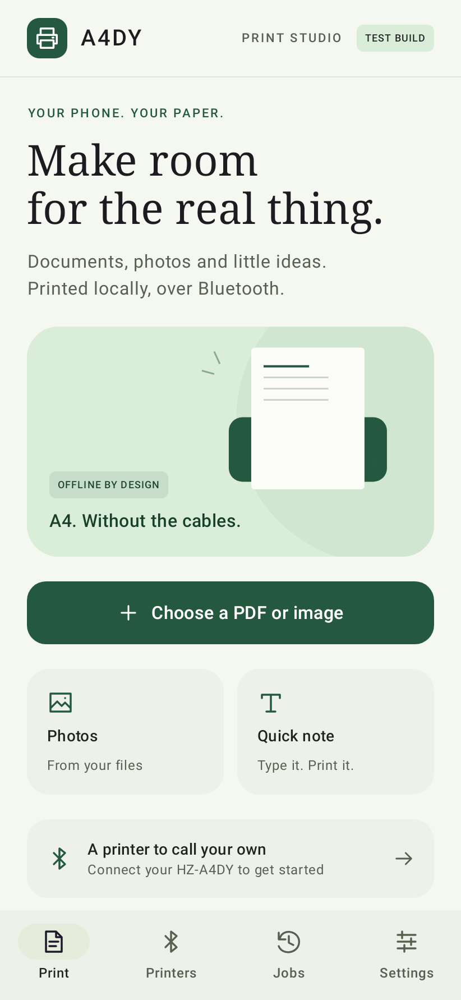

# A4DY Print for Android

An independent, original **Kotlin + Material 3** app for the **plain 203 dpi HZ-A4DY**, with both a standalone print studio and an Android system **PrintService**.

**Source version:** 0.1.0 · **Android:** 12 / API 31 or newer · **License:** MIT

**Release ID:** `app.a4dy.print` · **Debug ID:** `app.a4dy.print.debug` (`0.1.0-test`)

> **Initial physical success, still experimental.** A user successfully paired and connected, received firmware **v6.0.4** and battery raw **100** (units unknown), printed the built-in test strip, and printed through Android system printing. This is a **user report**, not assistant-run device instrumentation or broad hardware certification. The original build passed 70 automated tests and 27 offline vendor-packet comparisons. Ten device document tests remain **compiled but unrun**; advanced ranges/copies, cancellation/lifecycle and density/feed/DPI calibration still need testing. See [the evidence and remaining checklist](docs/TESTING.md).

## What is included

- PDF and image import through Android’s file picker, **Open with**, or **Share**; multiple PDFs/images can be combined in picker order.
- Typed notes and shared plain text converted to a local A4 PDF.
- Monochrome page preview; page ranges such as `1-3,5`; 1–99 copies; collated or uncollated order in the standalone app.
- A4 / A5 / Letter; fit or fill; margin; 90° rotation; mirror; negative; symmetric cropping; brightness, contrast, threshold and Floyd–Steinberg dithering.
- Bluetooth Classic SPP discovery, paired-device list, manual address entry, saved printer, connection/status query, firmware string and **raw** battery response. Battery units have not been established, so no invented percentage is displayed.
- Density and continuous/label feed settings. The default density is 0; the physical density range still needs testing.
- Serialized app/system jobs, foreground notification for standalone printing, progress, local cancellation, job history, redacted diagnostics and offline printer-stream export.
- An Android PrintService for printing from other apps. It advertises only the printer selected in the standalone app; it does not scan or connect merely because Android opens the print dialog.
- Light/dark theme, optional Material You wallpaper colours, original vector illustrations and icons.

The app has **no internet, location or broad-storage permission**, no account, ads, analytics, cloud upload, vendor SDK, Flutter runtime or proprietary artwork. Android’s file picker grants access only to files you choose. Imported documents are kept in private cache until cleared or removed by Android; history retains up to 30 titles/outcomes/counts. Backups and device-transfer backup rules are disabled.

### Deliberate first-release limits

English UI. PDF, supported Android images and plain-text notes only: **save Office documents as PDF first**. Direct `.txt` file import is not implemented; paste the text into Quick note or share the text itself. No scanning, OCR, web capture, vendor templates, tattoo algorithms or cloud features. No BLE/GATT or USB transport. **300 dpi / Pro models are not supported by this profile**, even if their names look similar. Other DY-family names are not a compatibility guarantee.

## Get an APK

- **Every branch push:** [Debug APK workflow](https://github.com/dm1sh/hz-a4dy-android/actions/workflows/debug.yml). Open a successful run and download `A4DY-Print-debug-<commit>`. The ZIP contains the app APK, a separate instrumentation-test APK, checksums, verification output and build metadata. Install the ordinary app APK, **not** the `-androidTest.apk` helper. GitHub may require sign-in for Actions artifacts; these downloads expire after 30 days.
- **Version tags:** the [Release APK workflow](https://github.com/dm1sh/hz-a4dy-android/actions/workflows/release.yml) builds a separately signed APK and publishes it under [GitHub Releases](https://github.com/dm1sh/hz-a4dy-android/releases). A release appears only after a matching version tag is pushed; no tag is implied by a source push.
- The originally supplied **`A4DY-Print-0.1.0-test.apk`** remains a separate historical test build. It is not checked into this repository.

Release and debug apps can coexist because their IDs differ. CI uses a stable **debug-only** key, separate from the release key. The original manually supplied APK used a different debug certificate: uninstall that old test app once if Android rejects the first CI build as an incompatible update (uninstalling erases its local data). Local builds may also have a different debug certificate.

## Install and connect

1. Transfer/download the chosen APK to an Android 12+ phone.
2. Open it and, if Android requests it, allow installation from that particular file/download source. Debug builds are test builds, not Play Store or manufacturer releases. No root is required.
3. In Android Bluetooth settings, pair the printer using the printer’s documented pairing procedure. Close HyPrint and other printer apps; many printers allow only one SPP connection at a time.
4. Open **A4DY Print → Printers**, grant **Nearby devices**, select the correct printer, and tap **Connect**. On Android 13+, notifications are optional but useful for progress/cancel while the app is in the background.
5. Load suitable thermal paper and choose **Print a small test strip**. This sends a 640 × 200 dot pattern at density 0 and a short continuous feed.
6. Inspect the strip. Only then try a short PDF or image. After any interrupted transfer, inspect the paper before retrying manually.

The APK can coexist with the vendor app, but close the vendor app before connecting. Begin conservatively on your own phone/printer even though an initial test succeeded.

### Enable printing from other apps

First select a printer and grant Nearby devices in A4DY Print. Then:

**Printers → Open Android printing settings → A4DY Bluetooth printing → Enable**.

From another app choose **Print**, select your configured printer, choose paper/range/copies, and submit. Only monochrome, single-sided printing is advertised. System jobs use **collated** software copies. Their selected-page PDF is treated as already processed by Android; the original page range is not applied twice. Standalone image geometry settings such as mirror/crop are deliberately not inherited into system jobs. Density, feed and tonal defaults are shared.

See [the testing guide](docs/TESTING.md) for page-range/copy checks and known limits.

## Important operating semantics

- **“Sent” / Android job completion means data was transmitted and a ready response was received. It does not prove a physical sheet finished.** No reliable completion/eject signal has been established.
- **Cancel closes the socket and stops local work.** It cannot retract bytes already buffered in the printer. No physical cancel command was recovered.
- No automatic retry of a partially transmitted page, no automatic resume after process death, and no silent reprinting of an interrupted system job.
- An initial readiness check can refuse a job before sending page data. If status is unavailable, save diagnostics instead of repeatedly submitting full jobs.
- Reply boundaries and timeouts are bounded implementation heuristics. Broader real-device tests may require protocol/timing revisions.
- Offline **Export printer stream** saves a `.bin` containing the same density/page commands without Bluetooth or paper use. It is **not a PDF, not the Linux USB protocol, and not a file to send to a USB/CUPS queue**.

## Build from source

Use **JDK 21** and Android SDK **platform 36 / build-tools 35.0.0**; the wrapper downloads checksum-pinned Gradle 8.13. Gradle/Android libraries require internet access during the build, but the installed app does not.

```sh
export ANDROID_HOME=/path/to/android-sdk
# Or set sdk.dir=/path/to/android-sdk in untracked local.properties.
./gradlew :app:assembleDebug
```

Output: `app/build/outputs/apk/debug/app-debug.apk`.

Pinned versions: AGP 8.13.1, Kotlin 2.2.21, Compose BOM 2025.04.01. Java/Kotlin output targets JVM 17. Version name/code live in `version.properties`. Normal local debug signing uses your own debug keystore; private signing keys/passwords are **never committed or included in the source archive**. If Android reports `INSTALL_FAILED_UPDATE_INCOMPATIBLE`, uninstall the existing debug build first (erasing its local data), then install your build.

### Automated checks

```sh
python3 -m unittest discover -s tools/tests -v
# On a small machine, compile and run Android tests as separate commands.
./gradlew :app:compileDebugUnitTestKotlin :app:compileDebugAndroidTestKotlin
./gradlew :core:test :app:testDebugUnitTest
./gradlew :app:lintDebug
./gradlew :app:assembleDebug :app:assembleDebugAndroidTest
```

Both GitHub workflows run the CI-helper tests, core/host tests and variant lint, validate the Gradle wrapper, and verify APK signatures, package/version metadata and 16 KB ZIP alignment before uploading APKs and SHA-256 checksums. The optional proprietary-bytecode comparison is **not** run in CI; no vendor binary is downloaded by the workflows. Pull-request debug builds use no repository signing secrets.

The project is configured for one Gradle worker and modest memory; larger machines can raise the limits in `gradle.properties`. Running compilation, dexing, lint and all tests together can exhaust a 2 GB build host. The **10 device document tests have not been run**; with a phone/emulator attached:

```sh
./gradlew :app:connectedDebugAndroidTest
```

See [TESTING.md](docs/TESTING.md) for exactly what was and was not validated, [RELEASING.md](docs/RELEASING.md) for signing and version tags, and [PROTOCOL.md](docs/PROTOCOL.md) for the optional hash-pinned vendor probe.

## Source map and evidence

- `core/` — bounded raster conversion, packet encoding, status parsing, page/copy selection; plain JVM tests.
- `app/` — Material 3 UI, private imports, Android rendering, SPP transport, foreground service and PrintService.
- `.github/workflows/` — debug-per-branch-push and signed-release-per-version-tag automation.
- `config/signing-certificates.json` — **public** certificate fingerprints, not private keys.
- `research/` — provenance, hashes, packet probe, static-analysis index, AOSP range evidence, original build evidence and the later user hardware report. No vendor binaries or decompiled class implementations are distributed.
- [Protocol and uncertainties](docs/PROTOCOL.md)
- [Vendor feature audit / first-release scope](docs/FEATURE_AUDIT.md)
- [Testing and hardware checklist](docs/TESTING.md)
- [Release and signing guide](docs/RELEASING.md)
- `docs/screenshots/` — real Compose screens drawn under Robolectric; not phone screenshots or hardware validation.
- `docs/hardware/first-test-strip.jpg` — user-supplied physical print photograph, camera metadata removed; not a DPI or density measurement.



## Licensing

Original application, core, tools and documentation: [MIT](LICENSE). AndroidX, Kotlin, kotlinx.coroutines and the Gradle wrapper have their own open-source licences; runtime notices and the Apache 2.0 licence are bundled under `app/src/main/assets/licenses/`. Printer names and HyPrint identify interoperability only. This project is not affiliated with or endorsed by the manufacturer or HyPrint.

The previously delivered Linux/CUPS driver is separate and unchanged. Its USB evidence and this app’s Bluetooth evidence remain distinct.
