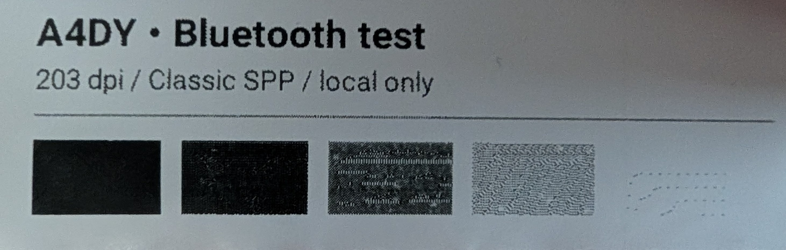

# Validation report and hardware test plan

## Bottom line

**Initial physical printing is now user-reported successful.** The user installed the supplied test app, paired and connected, received firmware **v6.0.4** and battery raw **100** (units unknown), printed the built-in strip, and successfully used **Android system printing**. Phone model and Android version were not provided. This is the user’s physical test, not assistant-executed instrumentation or a broad device/firmware matrix.

The original build validation happened **before** that report. Its logs and `research/validation/summary.json` remain historical evidence; their false physical-test flags refer to that earlier session only. The later report is recorded in `research/hardware-user-report.json`.

All **70 automated tests pass**, with no skipped tests in that executed set. Another **27 offline comparisons** match the selected vendor print bytecode exactly. Ten separate device document tests compile and their instrumentation APK builds, but those tests **have not run**.

These are different evidence levels; do not treat a passing Robolectric test or APK signature check as phone/printer validation. The new CI helpers additionally have 12 standard-library Python tests; their results are separate from the original 70 Kotlin/Android host tests.

### User-supplied physical evidence



The user’s photo shows the test heading, rule and tonal patches on paper. EXIF orientation was applied and camera metadata removed before committing this copy; the printed content was not retouched. A photograph is not a DPI, density, feed-distance or margin measurement. No advanced range/copy, cancellation/lifecycle, calibrated density/feed or device-document-instrumentation result was supplied.

## Original build-only checks

| Check | Result | What it covers |
|---|---|---|
| `:core:test` | **29 / 29 passed** | 13 protocol tests; 16 raster, cancellation, selection and copy-order tests |
| Android import/image renderer tests | **7 / 7 passed** | Robolectric API 31 native graphics: image sniffing, actual image raster/fit/fill/mirror/rotation/margins, small test strip, invalid/empty input and URI restrictions |
| Reply collector tests | **4 / 4 passed** | Fragmented acknowledgement, empty timeout, closed channel and bounded oversized reply |
| Runtime tests | **9 / 9 passed** | In-memory printer link: serialization, copy order, identical offline export packets, failure without retry, cancellation/close, readiness gating and diagnostic redaction |
| Preferences / service-range / manifest tests | **18 / 18 passed** | Nine tests each under Robolectric APIs 31 and 35: options/history persistence and recovery, redaction, page ranges applied once, service declaration and absence of internet/location permission |
| Compose UI tests | **3 / 3 passed** | Real Material 3 activity layout/navigation, actual image preview and adjustment controls, range validation, configured-printer display without connecting; Robolectric API 31 |
| Isolated vendor-bytecode probe | **27 / 27 exact packet matches** | Nine raster sizes × paperType 0/1/2, vendor `M2.a` translation vs new core; no network or Bluetooth |
| `:app:assembleDebug` | **Passed** | Android source compilation, resources, manifest, DEX and APK packaging |
| `:app:assembleDebugAndroidTest` | **Passed** | Device document test source compilation and instrumentation APK packaging only |
| `:app:lintDebug` | **Passed: 0 errors, 22 warnings** | Remaining warnings: 12 KTX-style suggestions, 8 Android dependency-version notices, 2 newer-version notices; no permission errors or lint baseline suppressing errors |
| `apksigner verify` | **Passed** | APK Signature Scheme v2; standard Android debug certificate |
| `zipalign -c -P 16 -v 4` | **Passed** | APK/native-library alignment checks |
| `aapt2 dump badging/permissions` | **Passed inspection** | Package/version, min API 31 / target API 36, four ABIs, requested permissions |

`research/validation/` contains JUnit XMLs, successful build/test/lint logs, lint warnings, APK metadata, signature and alignment reports. `research/vendor-packet-probe.json` contains packet-comparison details and input hashes. Release checksums and the debug-certificate fingerprint are supplied with the APK.

### Screenshots

`docs/screenshots/{home,document,printers,settings}.png` were captured by drawing the **actual measured Compose activity view tree under Robolectric native graphics**. The document screenshot uses an original synthetic PNG, then the real image raster/preview path. They are not AI image mockups, emulator captures, physical-device screenshots, or PDF-rendering evidence. Native PixelCopy/display-fence capture is not available in this desktop setup.

## Not executed / not established

- Broader Android/OEM behavior, permission dialogs and foreground-service enforcement across Android 12–16. Basic installation/launch and pairing/connection are covered only by the initial user report, on an unspecified phone/Android version.
- The **10 device document tests remain unrun**: real `PdfDocument`/`PdfRenderer` fixture checks, fonts, multipage notes and transformation/isolation cases. Basic system printing was user-reported successful, but it does not establish this whole rendering matrix. Robolectric does not implement the PDF paths sufficiently; attempted desktop PDF probes were **not** counted as passing tests.
- Secure versus optional insecure fallback, sustained throughput, timing/fragmentation/coalescing stress and status/error replies across firmware. Firmware v6.0.4 and battery raw 100 were returned in the initial successful connection report; battery units remain unknown.
- Physical DPI, margins/head alignment, density range/heat effects, measured continuous feed, label mode, exact physical copy counts or when a sheet has finished.
- Advanced PrintService page-range/copy handling across OEM variants, Binder/lifecycle stress, notification cancellation, process death, screen-off behavior or Bluetooth permission revocation mid-job. Basic Android system printing succeeded according to the user.
- General accessibility, screen-reader, large-font, tablet, translated-language and OEM layout testing. The app uses Material controls and content descriptions but is not accessibility-certified.

## Reproduce the automated checks

Requirements: JDK 21, SDK platform 36 and Android SDK build tools (AGP selects 35.0.0 here). Dependency versions are pinned in Gradle. Use the wrapper, not an arbitrary system Gradle.

```sh
# Set ANDROID_HOME or local.properties first.
python3 -m unittest discover -s tools/tests -v
./gradlew :app:compileDebugUnitTestKotlin :app:compileDebugAndroidTestKotlin
./gradlew :core:test :app:testDebugUnitTest
./gradlew :app:assembleDebug :app:assembleDebugAndroidTest
./gradlew :app:lintDebug
```

On the 2 GB / 2 CPU host, compilation and validation were split into fresh Gradle invocations. A large combined compilation/dex/lint/test invocation exhausted memory during development. The final settings use one worker, in-process Kotlin, a 512 MB Gradle heap, Serial GC, a bounded code cache, and 384 MB test workers forked per test class. The final split commands above succeeded. No daemon/process generated files are required in the source archive.

The image decoder may print an “unimplemented” diagnostic during the deliberate invalid-image test; that test verifies rejection and cache cleanup and passes. Native image file decoding at API 35 also exceeded this Robolectric setup’s supported native bindings, so image/UI rendering is tested at API 31; non-graphics tests run at both 31 and 35. This is not a claim that API 35 PDF/image/device behavior has been exercised.

### Device tests, when a phone or emulator is available

```sh
adb devices
./gradlew :app:connectedDebugAndroidTest
```

The ten device document tests include real text/PDF creation and reading, multipage notes, image rendering/rotation/mirroring/fill/margins, PDF preview dimensions, rejected inputs, spool/cache isolation and test-strip rendering. They do **not** send Bluetooth data. Run them before treating the document-rendering fixture matrix as verified; the basic user printing report is narrower evidence. If you have the supplied APK installed and build with a different debug key, uninstall it before installing your own build/test APKs.

## Why the system service does not select pages twice

AOSP Android 12 `PrintActivity.DocumentTransformer` removes unwanted pages from the PDF and changes `PrintJobInfo.pages` to `ALL_PAGES`. Current AOSP code inspected in this session follows the same pattern. Sometimes there is no transformation because the file already contains only the requested pages. Therefore:

- Use indices in the **delivered PDF** and any remaining delivered `PrintJobInfo.pages`, exactly once.
- Do not reapply the standalone page-range field or infer original document page numbers.
- Expand `PrintJobInfo.copies` once in software, collated; do not multiply an already expanded app sequence.
- Read `PrintJob` / `PrintDocument` APIs on the main thread, then copy the returned descriptor off-thread and close it. Rendering also stays off the main thread.
- Cancellation closes the descriptor/socket. Jobs found already started/blocked after service interruption fail with a manual-inspection warning rather than replaying paper.

Sources and observations: `research/android-spooler-evidence.json`. The unit tests cover range/copy algorithms, not a live Android spooler. The user’s later basic system-print success does not yet cover the advanced range/copy cases. This avoids repeating the upstream copy-order assumptions that caused the separate Fedora/CUPS investigation.

## Hardware checklist — conservative order for further testing

The initial user report covers pairing/connection, the small strip and a basic system print. Do not mark the remaining cases passed without observing them.

1. **Confirm model.** Use a plain HZ-A4DY/203 dpi device, not a similarly named Pro/300 dpi printer. Charge it and load the appropriate thermal paper. Keep the vendor app closed.
2. **Pair and query only.** Grant Nearby devices, pair in Android settings, select the printer, and tap Connect. Record Ready/Unknown/error and firmware if returned. Battery is a raw code. If not ready, stop and save diagnostics.
3. **Small strip.** Use density 0, continuous mode and the built-in 640 × 200 strip. It will consume paper plus feed. Check orientation, black/white polarity, band corruption and feed. Do not immediately retry after an ambiguous failure: inspect the paper first.
4. **One short page.** Import a simple PDF and an image separately. Compare their app previews with paper; check scale, clipping, margins and rotation. Measure a known length if verifying the 203 dpi assumption.
5. **Two-page ordering.** Use clearly marked A/B pages. One copy should produce A B. Standalone two copies: collated A B A B; uncollated A A B B. Inspect every sheet/section rather than relying on the job count.
6. **System service.** Enable A4DY Bluetooth printing. From another app test all pages, only page 2, a noncontiguous range, two copies, landscape and each advertised media size. Confirm no double-selection/double-copying.
7. **Failure and lifecycle checks.** Try cover open/no paper before a job; power off during transfer; cancel from the app, notification and Android queue; rotate the phone and turn the screen off. A partial job must never restart itself. Already-buffered paper may still finish after Cancel.
8. **Review and share diagnostics.** Settings → Save redacted diagnostics. Review the JSON before sharing. Include phone model/Android version and a description or photo of the strip separately if comfortable; the app does not upload them automatically.

Stop if the printer overheats, produces unexpected sustained black output or feeds incorrectly. Never increase density or repeatedly resubmit a large job to compensate for an unknown protocol failure.

## Continuous integration evidence

The debug workflow runs the host suite and debug lint on every branch push; the release workflow reruns host tests and release lint for version tags. Both compile device-test sources but do **not** execute connected-device instrumentation. Each run uploads its own current reports rather than replacing the historical build evidence above. APK bundles include commit/version/certificate metadata, signature/alignment verification and SHA-256 checksums. See [RELEASING.md](RELEASING.md).
